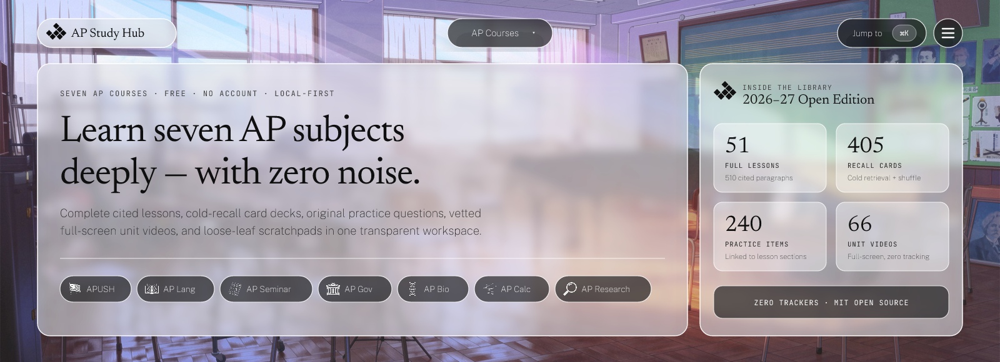

<div align="center">
  <a href="https://ap-study-hub-five.vercel.app">
    <picture>
      <source media="(prefers-color-scheme: dark)" srcset="./assets/readme/banner-dark.png" />
      <source media="(prefers-color-scheme: light)" srcset="./assets/readme/banner-light.png" />
      
    </picture>
  </a>

  <br />

  <p>
    <strong>Nine AP courses in one study hub — with 66 cited lessons, 525 recall cards, 429 original practice questions, 82 full-screen unit videos, and loose-leaf scratch paper.</strong>
  </p>

  <p>
    <a href="https://ap-study-hub-five.vercel.app"></a>
    <a href="#the-catalogue"></a>
    <a href="#the-catalogue"></a>
    <a href="./LICENSE"></a>
    <a href="./AI_DISCLOSURE.md"></a>
  </p>

  <p>
    <a href="https://ap-study-hub-five.vercel.app"><strong>Open the hub</strong></a>
    &nbsp;·&nbsp;
    <a href="https://ap-study-hub-five.vercel.app/study">Study Desk</a>
    &nbsp;·&nbsp;
    <a href="https://ap-study-hub-five.vercel.app/videos">Unit Videos</a>
    &nbsp;·&nbsp;
    <a href="https://ap-study-hub-five.vercel.app/guides">Study Guides</a>
    &nbsp;·&nbsp;
    <a href="./AI_DISCLOSURE.md">AI Disclosure</a>
  </p>
</div>

---

## Why this exists

Studying for several AP classes at once usually turns into eleven browser tabs — a 240-page Course and Exam Description PDF, a summary sheet with half the units missing, an ad-heavy flashcard deck, and a video queue full of unrelated recommendations.

**AP Study Hub** puts the entire study loop for nine AP subjects inside one quiet, zero-account workspace:

- **Complete cited lessons** — 66 full-length unit lessons (`660` cited prose paragraphs, learning objectives, worked examples, primary sources, and common mistakes).
- **Cold-recall decks** — 525 active-recall flashcards (course decks + unit glossary terms) with keyboard flip, Fisher–Yates shuffle, and local spaced-review scheduling.
- **Exam-register practice & timed writing** — 429 original multiple-choice questions that link wrong answers back to the exact lesson section, plus timed essay outlines and mock papers with college-ruled scratch paper.

There are **no accounts, no paywalls, no ad scripts, and no analytics trackers**. Progress, due cards, missed questions, and timed drafts live locally in `localStorage` on your own device and can be exported to JSON or Markdown at any time.

---

## The Catalogue

Every count in the UI and metadata is computed at build time from `src/content/` and verified by `pnpm check`.

| Course | White Symbol | Units & Lessons | Cited Paragraphs | Recall Cards | Practice Qs | Essays & Mock Papers | Unit Videos |
| :--- | :--- | :---: | :---: | :---: | :---: | :---: | :---: |
| **AP U.S. History** (`apush`) | Waving U.S. flag | 9 | 90 | 89 | 66 | 1 essay · 1 mock | 13 |
| **AP English Language** (`ap-lang`) | Open book | 9 | 90 | 81 | 66 | 3 essays · 1 mock | 9 |
| **AP Seminar** (`ap-seminar`) | Source documents | 5 | 50 | 56 | 48 | 1 essay · 1 mock | 10 |
| **AP U.S. Gov & Politics** (`ap-gov`) | Classical capitol | 5 | 50 | 40 | 35 | 4 essays · 0 mocks | 6 |
| **AP Biology** (`ap-bio`) | DNA double helix | 8 | 80 | 52 | 47 | 0 · 0 | 8 |
| **AP Calculus AB** (`ap-calc`) | Right triangle (`cos θ`) | 10 | 100 | 55 | 50 | 0 · 0 | 10 |
| **AP Research** (`ap-research`) | Magnifying glass | 5 | 50 | 32 | 30 | 1 essay · 0 mocks | 10 |
| **AP Macroeconomics** (`ap-macro`) | Rising market graph | 6 | 60 | 54 | 39 | 1 essay · 0 mocks | 6 |
| **AP Environmental Science** (`ap-env`) | Leaf | 9 | 90 | 66 | 48 | 1 essay · 0 mocks | 10 |
| **Total** | **9 white RGBA icons** | **66** | **660** | **525** | **429** | **12 essays · 3 mocks** | **82** |

---

## Architecture & Study Flow

```text
  Lessons (/course/[slug]/notes)            Recall Decks (/cards)             Practice & Studio (/practice · /exam)
 ┌──────────────────────────────────┐      ┌──────────────────────────┐      ┌───────────────────────────────────────┐
 │ 66 lessons · 660 cited paragraphs│ ───► │ 525 recall cards         │ ───► │ 429 MCQs + 12 essays + 3 mock papers   │
 │ Objectives, worked examples,     │      │ Space/Enter flip,        │      │ Wrong answers jump straight back to   │
 │ primary sources, unit videos     │ ◄─── │ local SM-2 review queue  │ ◄─── │ the exact lesson section & scratchpad │
 └──────────────────────────────────┘      └──────────────────────────┘      └───────────────────────────────────────┘
```

### Privacy-first unit videos (`UnitVideoPlayer`)
- Every course unit includes vetted review videos (`Heimler's History`, `Coach Hall Writes`, `Garden of English`, `Bozeman Science`, `Amoeba Sisters`, `3Blue1Brown`, `Professor Leonard`, `Carey LaManna`, and official `Advanced Placement` playlists) verified via YouTube oEmbed (`scripts/validate-videos.ts`).
- Pages render static `i.ytimg.com` thumbnails first — **no YouTube scripts or `<iframe>` embeds load until you explicitly opt in** (`youtube-nocookie.com`), or you can open the video directly on YouTube in a new tab.

### Local-first persistence & optional integrations
- Core study state uses clean `aps:*` `localStorage` keys (`use-stored-state.ts` + `study-store.ts`) — zero cookies, zero telemetry, instant JSON backup/restore, `.apkg`-ready Anki TSV/CSV export, `.ics` exam calendar export, and Markdown portfolio export.
- Optional student-supplied connectors (`/integrations`) support **GitHub Gist** cross-device sync and **Google Drive / Notion / Quizlet / Obsidian** import-export formats using tokens you control locally.

---

## Quick Start & Verification

Requires **Node.js 20+** and **pnpm 9+** (`corepack enable`).

```bash
git clone https://github.com/Nikoxkx/Ap-Study-Hub.git
cd Ap-Study-Hub
corepack pnpm install
corepack pnpm dev          # http://localhost:3000
```

Run the full validation and production build pipeline before opening a PR:

```bash
corepack pnpm validate:content        # 66 lessons, 660 paragraphs, citations, glossary & practice schema
corepack pnpm validate:study          # 645 study items, KaTeX math, scheduling, backups, plans & calendar
corepack pnpm validate:presentation   # dark-mode neutral hex tokens, white RGBA marks, CSP, 1200×630 OG PNGs
corepack pnpm validate:videos         # 82 verified 11-char YouTube IDs, course/unit mapping & thumbnails
corepack pnpm build:banners           # regenerate assets/readme/banner-{light,dark}.png
corepack pnpm build:social            # regenerate public/og-image.png & public/social-preview.png
corepack pnpm check                   # runs all 4 validators + tsc --noEmit + eslint + next build
corepack pnpm audit --audit-level low # checks direct and transitive dependencies for known advisories
```

The dependency audit also runs on dependency-changing pull requests, on merges to `main`, and weekly via GitHub Actions. Keep `pnpm-lock.yaml` in sync with `package.json` so the audit checks the versions actually installed.

---

## Repository Map

```text
assets/
  readme/
    build-banners.mjs           renders README banners over bg-music-class.jpg with frosted glass UI & Logo
    banner-light.png            1600×580 light-mode classroom wallpaper + frosted glass UI banner
    banner-dark.png             1600×580 dark-mode twilight classroom + smoked glass UI banner
  social/
    og-image.svg                1200×630 Open Graph / social card source SVG
public/
  bg-music-class.jpg            wallpaper: /, /about
  bg-corridor.jpg               wallpaper: /study, /search, /integrations, /ai-disclosure
  bg-class.jpg                  wallpaper: /course/[slug], /cards, /videos, /guides
  bg-class2.jpg                 wallpaper: /notes, /practice, /studio, /essays, /exam, /resources, /print
  fonts/                        self-hosted WOFF2 subsets (Newsreader, Public Sans, JetBrains Mono, Kalam)
  icons/courses/                9 pure-white (#FFFFFF) transparent RGBA AP course symbols
  og-image.png                  compiled 1200×630 Open Graph card
  social-preview.png            compiled 1200×630 GitHub / social preview card
  sw.js                         same-origin offline service worker
scripts/
  validate-lessons.ts           verifies lesson depth, citations, cards, and practice integrity
  validate-study.ts             verifies study catalog joins, KaTeX math, scheduling, backups, and exports
  validate-videos.ts            verifies curated YouTube IDs and unit coverage
  validate-presentation.mjs     enforces neutral dark tokens, SubjectMark icons, video privacy, and PNG headers
  build-social-image.mjs        renders 1200×630 social cards over bg-music-class.jpg via @resvg/resvg-js
src/
  app/                          Next.js 16 App Router (static routes, loading boundaries, /api/search)
  components/
    SiteHeader.tsx              single-row leveled header bar (Logo, TopClassBar, Jump to ⌘K, MobileNav)
    SiteHeaderShell.tsx         directional scroll-fade shell preserving fixed modal viewports
    TopClassBar.tsx             hover-reveal AP Courses bar + mobile touch sheet with white AP symbols
    MobileNav.tsx               unified Menu popover (SiteSearch, Study Desk, links, ThemeSwitch)
    StudySystemVisual.tsx       interactive 7-course cold-recall card preview inside the homepage hero
    StudyDashboard.tsx          spacious local-first Study Desk with white AP course filter pills & 8 tabs
    SubjectMark.tsx             7 pure-white RGBA AP course symbols across light glass & neutral night mode
    UnitVideoPlayer.tsx         click-to-load youtube-nocookie player + conflict-free full-screen view
    CardDeck.tsx                keyboard-first active-recall flashcard deck
    PracticeSet.tsx             accessible multiple-choice runner with section-level remediation
    TimedPaper.tsx              essay & mock-exam workspace with autosave + NotebookPaper scratchpad
    study/AdvancedDesk.tsx      spaced-review queue, missed-question drill, and study analytics
    ui/
      PageBackground.tsx        route-mapped full-viewport classroom/corridor wallpaper layer
      Logo.tsx                  universal 45°-rotated 7-square geometric mark
      BanterLoader.tsx          9-box kinetic geometric symbol
      LoadingSpinner.tsx        universal 3-circle + 3-shadow bouncing loader
      ThemeSwitch.tsx           compact Sun / Moon / Clouds / Stars theme switch
      NotebookPaper.tsx         reusable college-ruled loose-leaf scratch paper sheet
      ScrollEffects.tsx         60fps exponential-lerp bidirectional viewport-edge fade controller
  content/                      typed curriculum, 66 deep lessons, sources, channels, and unit videos
  lib/                          catalog aggregator, weighted search index, local store, and JSON-LD schema
```

---

## Honesty, Trademarks & License

- **Independent student project** — AP® and Advanced Placement® are registered trademarks of the College Board, which was not involved in the production of, and does not endorse, this site. All 429 practice questions, 525 recall cards, and 66 lessons are original study material written from public curriculum frameworks and open textbooks; no secure exam items are reproduced.
- **Fonts & artwork** — Self-hosted `Newsreader`, `Public Sans`, `JetBrains Mono`, and `Kalam` are licensed under the SIL Open Font License 1.1 (`public/fonts/`). Background classroom and corridor paintings are original environment illustrations by Arseniy Chebynkin.
- **AI transparency** — Every place where AI tools assisted with scaffolding, drafting, or validation is documented openly in [`AI_DISCLOSURE.md`](./AI_DISCLOSURE.md) and [`/ai-disclosure`](https://ap-study-hub-five.vercel.app/ai-disclosure).
- **Code license** — Released under the [MIT License](./LICENSE).
