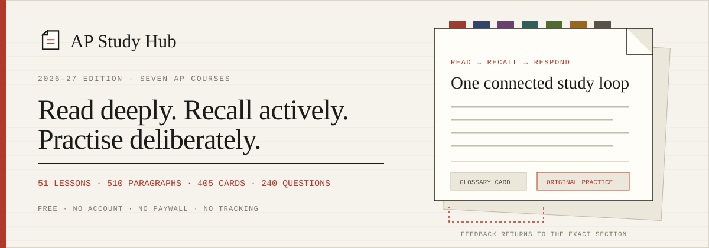

<div align="center">

  <a href="https://v0-project-roan-six-20.vercel.app">
    <picture>
      <source media="(prefers-color-scheme: dark)" srcset="./assets/readme/banner-dark.svg" />
      
    </picture>
  </a>

  <p>
    <a href="https://v0-project-roan-six-20.vercel.app"></a>
    
    
    
    <br />
    
    
    
    <a href="./AI_DISCLOSURE.md"></a>
    
  </p>

</div>

# Deep AP lessons, built for active study.

AP Study Hub is a free, independent study library for seven AP courses. Its expanded
2026–27 edition combines complete lessons, glossary recall, original practice, marked
essays, and visible curriculum and scoring sources. Read the explanation, retrieve the
idea without looking, answer a question, then use the feedback to return to the exact
section that needs another look.

**Live at <https://v0-project-roan-six-20.vercel.app>** — no account, paywall, analytics,
or runtime AI.

<p align="center">
  <strong>51</strong> deep lessons &nbsp;·&nbsp; <strong>510</strong> substantive paragraphs &nbsp;·&nbsp;
  <strong>32,803</strong> teaching words &nbsp;·&nbsp; <strong>405</strong> cards &nbsp;·&nbsp;
  <strong>240</strong> original questions<br />
  <strong>6</strong> marked essays &nbsp;·&nbsp; <strong>3</strong> original timed sets &nbsp;·&nbsp;
  <strong>92</strong> resource links &nbsp;·&nbsp; <strong>1,196</strong> searchable documents
</p>

Not affiliated with the College Board. AP and Advanced Placement are registered
trademarks of the College Board, which has not reviewed or endorsed this site.

---

## 01 — The catalogue

The application computes these counts from the same catalog that renders the site.
“Lessons” are the expanded course units; legacy drills are retained where useful and
joined to the new lesson system rather than counted as additional deep lessons.

| Spine | Course | Lessons | Paragraphs | Cards | Original questions | Essays | Sources / resources | Teaching read |
| :---- | :----- | ------: | ---------: | ----: | -----------------: | -----: | ------------------: | ------------: |
| `USH` | [AP United States History](https://v0-project-roan-six-20.vercel.app/course/apush) | 9 | 90 | 89 | 48 | 1 | 16 | ~30 min |
| `LNG` | [AP English Language and Composition](https://v0-project-roan-six-20.vercel.app/course/ap-lang) | 9 | 90 | 81 | 48 | 3 | 13 | ~28 min |
| `SEM` | [AP Seminar](https://v0-project-roan-six-20.vercel.app/course/ap-seminar) | 5 | 50 | 56 | 38 | 1 | 13 | ~15 min |
| `GOV` | [AP United States Government and Politics](https://v0-project-roan-six-20.vercel.app/course/ap-gov) | 5 | 50 | 40 | 25 | — | 13 | ~15 min |
| `BIO` | [AP Biology](https://v0-project-roan-six-20.vercel.app/course/ap-bio) | 8 | 80 | 52 | 31 | — | 11 | ~22 min |
| `CAL` | [AP Calculus AB and BC](https://v0-project-roan-six-20.vercel.app/course/ap-calc) | 10 | 100 | 55 | 30 | — | 13 | ~25 min |
| `RES` | [AP Research](https://v0-project-roan-six-20.vercel.app/course/ap-research) | 5 | 50 | 32 | 20 | 1 | 13 | ~14 min |
| | **All seven** | **51** | **510** | **405** | **240** | **6** | **92** | **~149 min** |

The lesson library also contains **102 lesson-linked original questions** within the
240-question total and cites **41 registered curriculum, scoring, textbook, archive,
and research sources**. Every registered source is used.

### Course coverage

- **APUSH:** nine chronological periods, with contextualization, evidence, causation,
  comparison, continuity/change, and explicit DBQ/LEQ rubric connections.
- **AP Lang:** nine units spanning rhetorical situation, claims and evidence,
  reasoning, organization, and style, with separate synthesis, rhetorical-analysis,
  and argument guidance tied to the six-point analytic rubrics.
- **AP Seminar:** five QUEST-framework lessons for the current 2026–27 assessment:
  Team Project and Presentation (20%), Individual Research-Based Essay and Presentation
  (35%), and the end-of-course exam (45%). The 2027–28 redesign is not presented as
  current policy.
- **AP Gov:** five units with all fifteen required cases and thirteen foundational
  documents, including the four 2026–27 additions and the official clarification as a
  direct source.
- **AP Biology:** eight units connecting molecular and cellular mechanisms to evolution
  and ecology, with data analysis, experimental design, graphing, and FRQ practice.
- **AP Calculus AB/BC:** the eight AB units plus the two additional BC units. Inline
  notation, worked procedures, representation changes, calculator decisions, and
  justification language are searchable and rendered as part of each lesson.
- **AP Research:** five lessons for the 4,000–5,000-word academic paper (75%) and the
  presentation/oral defense (25%), including question design, method alignment,
  evidence, limitations, and reflection.

## 02 — What a deep lesson contains

Every lesson is a structured TypeScript document, not a single markdown blob:

1. **A precise overview and current exam-weight label.** AB and BC weights are labeled
   separately where the combined Calculus course requires it.
2. **At least three learning objectives.** These describe what a student should be able
   to explain, calculate, compare, design, or defend.
3. **At least five named teaching sections and ten substantive paragraphs.** Paragraphs
   develop mechanisms, historical context, reasoning, examples, misconceptions, and
   exam applications rather than repeating definitions.
4. **Section-level citations.** Official curriculum and scoring references are
   distinguished from open textbooks, archives, and writing guidance.
5. **A glossary of at least four terms.** These entries become lesson-linked cards.
6. **An exam and rubric connection.** The criteria explain how the material becomes a
   defensible answer instead of merely naming an exam task.
7. **At least two original practice questions.** Each has four options, a skill label,
   and a reasoned explanation.

`pnpm validate:content` enforces these minimums, the expected course sequence, unique
teaching paragraphs, valid and used source IDs, and practice structure. It also requires
at least 500 teaching words per lesson and 35 per paragraph as anti-stub baselines; those
floors are safeguards, not claims that word count alone proves quality.

## 03 — Study modes

| Mode | What the expanded system does |
| :--- | :---------------------------- |
| **Notes** | Server-rendered deep lessons with stable section anchors, objectives, inline mathematical notation, glossaries, rubric connections, bibliographies, and practice links. |
| **Cards** | The original deck plus lesson glossaries, with links back to the relevant lesson. Keyboard controls, Fisher–Yates shuffle, missed-only review, and versioned per-course storage remain available. |
| **Practice** | Legacy drills and lesson-linked questions in one set. Filter by lesson, receive reasoned feedback, and follow a review link back to the exact teaching section. |
| **Essays** | Six sample responses with point-by-point commentary. Constructed practice sources are identified rather than presented as genuine publications or quotations. |
| **Timed practice** | Three original sets with autosaved answers and a running clock: APUSH (155 minutes), AP Lang (195 minutes), and AP Seminar (120 minutes). They are not full-length released exams and do not claim to provide official automatic essay scores. |
| **Sources** | Ninety-two official, archival, textbook, writing, and supplemental links, including lesson bibliographies and checked dates where the source model provides them. |
| **Video lessons** | Twenty-nine embedded videos — at least four for every course — matched to the units students get stuck on. Each id was checked against YouTube before it was listed; see [`src/lib/videos.ts`](src/lib/videos.ts). Click-to-load, so a page with five videos still requests nothing from YouTube until you press play. |
| **Study desk** | Due Today spaced review, a mistake notebook, objective confidence, a plan built from your free evenings, focus sessions, a Watch tab that gathers every course's videos, and a Scratch tab: ruled paper with four pens that saves as you type. |

Search indexes **1,196 documents**, including individual teaching sections. Results can
therefore deep-link into a long lesson, preserve inline mathematical notation, and send
question hits to a filtered practice set.

## 04 — 2027 exam and deadline calendar

Dates below come from the official 2027 AP schedule. Reporting times and any local or
late-testing arrangements must be confirmed with the school’s AP coordinator.

| Course | Published date | Session / deadline |
| :----- | :------------- | :----------------- |
| AP Research | 30 April 2027 | Performance-task portfolio due at 11:59 p.m. ET |
| AP Biology | 3 May 2027 | Afternoon |
| AP U.S. Government and Politics | 4 May 2027 | Morning |
| AP United States History | 7 May 2027 | Morning |
| AP Calculus AB and BC | 10 May 2027 | Morning |
| AP Seminar | 10 May 2027 | Afternoon |
| AP English Language and Composition | 12 May 2027 | Morning |

The current-format notes in the lesson library also account for the May 2027 Calculus
MCQ timing/count changes, the 2026–27 AP Gov document additions, and the announced
APUSH free-response design changes. Official course and exam pages remain the authority.

## 05 — Accuracy and practice boundaries

- **Original practice is labeled.** Secure or unreleased AP material is not intentionally
  reproduced. Official released questions are linked rather than copied into the library.
- **Constructed sources say so.** Invented AP Lang, Seminar, Research, and APUSH practice
  documents are labeled as constructed; they are not attributed to real people or
  publications as though they were authentic artifacts.
- **Rubric connections are explicit.** Lessons distinguish thesis, evidence/commentary,
  sophistication, historical reasoning, sourcing, complexity, science practices, and
  mathematical justification as appropriate to the course.
- **Validation is not a substitute for judgment.** Automated checks prove structure and
  coverage constraints, not every nuanced historical or scientific claim. The named
  author retains editorial responsibility, and corrections are welcome.
- **Current versus future policy is separated.** In particular, the AP Seminar lessons
  target 2026–27; the redesign beginning in 2027–28 is not silently applied early.

## 06 — How it is built

- **Next.js 16.2.6, React 19.2.6, and strict TypeScript.** Content pages are statically
  generated; the search API is the dynamic exception.
- **One integrated catalog.** `src/lib/catalog.ts` joins subject metadata, rich lessons,
  legacy drills, cards, questions, resources, counts, and reading time.
- **No CMS or database.** Lessons and drills live in typed modules. There is no runtime
  content fetch and no account system.
- **No-JavaScript reading path.** Notes, essays, questions, and `/search` are rendered
  on the server. The header search form has a GET fallback.
- **Hand-built interface.** Native controls, hand-drawn SVG marks, Tailwind CSS, and a
  paper-and-ink design system; no component kit or icon package.
- **Local study state only.** Theme, versioned card marks (`aps.cards.v2.{course}`), and
  timed-practice drafts stay in the browser. No student work is sent to an AI service.
- **Self-hosted fonts.** Newsreader, Public Sans, and JetBrains Mono are bundled with
  their licenses; no font CDN is required.
- **Generated brand assets.** The favicon and Apple icon use the exact SiteMark sheet
  geometry. The Open Graph card and README banners use deterministic SVG/Next ImageResponse
  artwork rather than stock imagery or generated raster pictures.
- **A social card per page.** Every indexable route has its own `opengraph-image.tsx`, and
  they are drawn from one builder in `src/lib/og.tsx`, so a link to AP Bio cards previews as
  AP Bio cards — title, a written description, and a stamp carrying that page's own number —
  rather than as the home page. Cards are set in the site's real typefaces, subset and
  instanced into `assets/og/` (which is why `outputFileTracingIncludes` lists them).
- **Photographed paper.** `public/textures/` holds three photographs of real paper: a
  crumpled ruled sheet used as the desk behind everything, a lined sheet behind the masthead,
  and a torn edge cut to a transparency for note scraps. Dark mode keeps the same desk but
  turns it down and puts every panel on translucent glass, so the two themes are different
  materials rather than one palette inverted.
- **One rhythm for type.** Headings, sub-headings and body copy are spaced by the rules at
  the end of `globals.css` rather than by per-page margins, so nothing is crowded or adrift.

## 07 — Running it locally

Requires Node 20.9+ and pnpm 10.x. The repository pins `pnpm@10.29.1`; `corepack pnpm`
works in a clean Corepack environment.

```bash
corepack pnpm install
corepack pnpm dev

corepack pnpm validate:content  # depth, sequence, prose, sources, and practice
corepack pnpm typecheck         # TypeScript
corepack pnpm lint              # ESLint
corepack pnpm build             # production build
corepack pnpm check             # all four checks in that order

node assets/readme/build-banners.mjs  # regenerate README artwork
```

There is no database, CMS, or required environment file. `NEXT_PUBLIC_SITE_URL` only
changes canonical/sitemap origins; without it, the production origin is used.

## 08 — Repository map

```text
assets/readme/
  build-banners.mjs           deterministic light/dark banner source
  banner-light.svg            generated repository artwork
  banner-dark.svg
scripts/
  validate-lessons.ts         content-depth and citation validation
src/
  app/
    course/[slug]/            overview, notes, cards, practice, essays, timed practice, sources
    icon.tsx                  32px SiteMark-based browser icon
    apple-icon.tsx            maskable 180px version
    opengraph-image.tsx       generated social artwork
    ai-disclosure/            live AI-use and verification disclosure
  components/
    LessonContent.tsx          structured lesson renderer
    StudySystemVisual.tsx     read → recall → respond editorial illustration
    CardDeck.tsx PracticeSet.tsx TimedPaper.tsx
  content/lessons/
    types.ts                  lesson/source contracts
    sources.ts                cited source registry and checked dates
    build.ts                  paragraph-aware section helper
    text.ts                   shared teaching-word counter
    index.ts                  seven-course registry
    apush.ts apLang.ts apSeminar.ts apGov.ts apBio.ts apCalc.ts apResearch.ts
  lib/
    catalog.ts                integrated content/count/search join
    videos.ts                 checked video library, one entry per embed
    og.tsx                    shared social-card builder
  components/
    VideoShelf.tsx            click-to-load video cards
    ScratchPad.tsx            saved ruled scratch paper
    Paper.tsx                 torn-note furniture
  ../public/textures/         photographed paper: desk, lined sheet, torn edge
    data.ts                   legacy drills, essays, resources, and timed sets
    subjects.ts               course metadata and 2027 dates
    search.ts                 section-level scored index
    markdown.tsx              prose and inline mathematical notation
```

## 09 — Adding content or correcting an error

1. Add or edit the course module in `src/content/lessons/` for deep teaching content.
   Use `src/lib/data.ts` for legacy drills and timed-practice material.
2. Register every citation in `sources.ts`, with a useful title, publisher, HTTPS URL,
   source kind, description, and checked date.
3. Keep the lesson sequence aligned with the current official framework. Distinguish
   official curriculum/scoring references from supplemental explanations.
4. Run `corepack pnpm validate:content` and `corepack pnpm typecheck` while iterating;
   run the complete `corepack pnpm check` before opening a pull request.
5. Update the course’s `revised` date when its substance changes. For a material
   library-wide revision, update `site.contentRevision` as well.
6. Do not hard-code a new count in application copy when `getTotals()` or course
   `counts` can compute it. This README’s static table should be refreshed after a
   deliberate content release.

The fastest correction is a [GitHub issue](https://github.com/Nikoxkx/Ap-Study-Hub/issues)
with the page URL, the disputed claim, and a source. Correction PRs are especially welcome.

### Planning artifacts

- [Implementation plan](https://docs.google.com/document/d/1TxBh80EghP9Oh5qVcSEyZqdo3MhVg6a6pBPQpbnagrI/edit)
- [Lesson coverage workbook](https://docs.google.com/spreadsheets/d/16PcbQl6vsF6UAmxSw6Y8JBYFwqe5zrclL71dT3AhAmY/edit)

## 10 — AI disclosure

AI tools were used for drafting, research workflow, scaffolding, and code. The 2026–27
expansion used Arena.ai Agent Mode alongside the previously disclosed v0.dev, ChatGPT,
Claude, and GitHub Copilot workflows. The expanded lessons are source-linked and checked
with automated content and TypeScript validation; that is not represented as proof that
every sentence received independent expert review.

There is no chatbot, AI grader, AI API, or student-data transfer in production. Visual
assets are deterministic SVG or Next ImageResponse compositions, not AI-generated raster
images. See [AI_DISCLOSURE.md](./AI_DISCLOSURE.md) and `/ai-disclosure` for the detailed
breakdown and correction policy.

Last updated: **2026-10-24** · Content revision: **2026.10**

## Licence

Code is MIT. Course content is © the author. Bundled typefaces are under the SIL Open
Font License 1.1; license texts are in `public/fonts/`.

---

<div align="center">
  <sub>
    AP Study Hub · Independent · Est. 2025 · Not affiliated with or endorsed by the College Board<br />
    AP and Advanced Placement are registered trademarks of the College Board.
  </sub>
</div>
